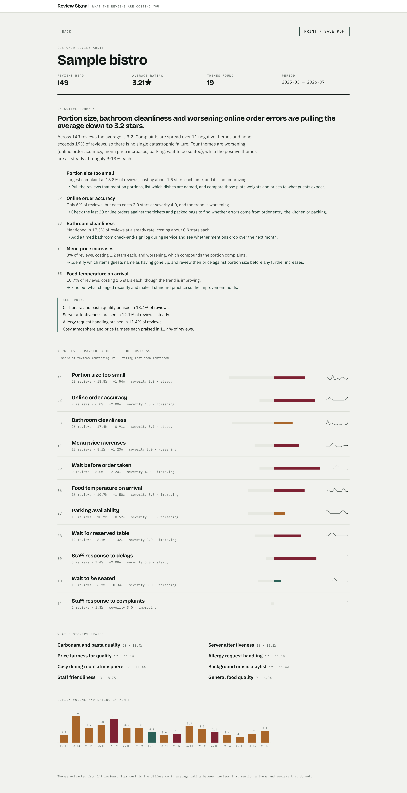
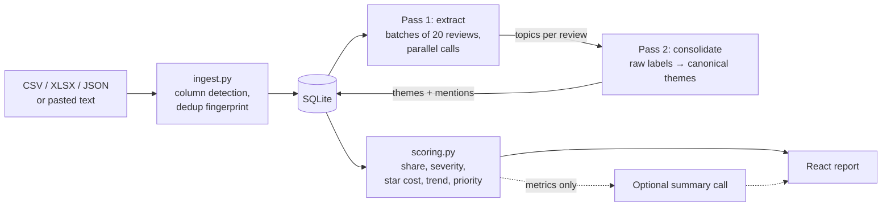
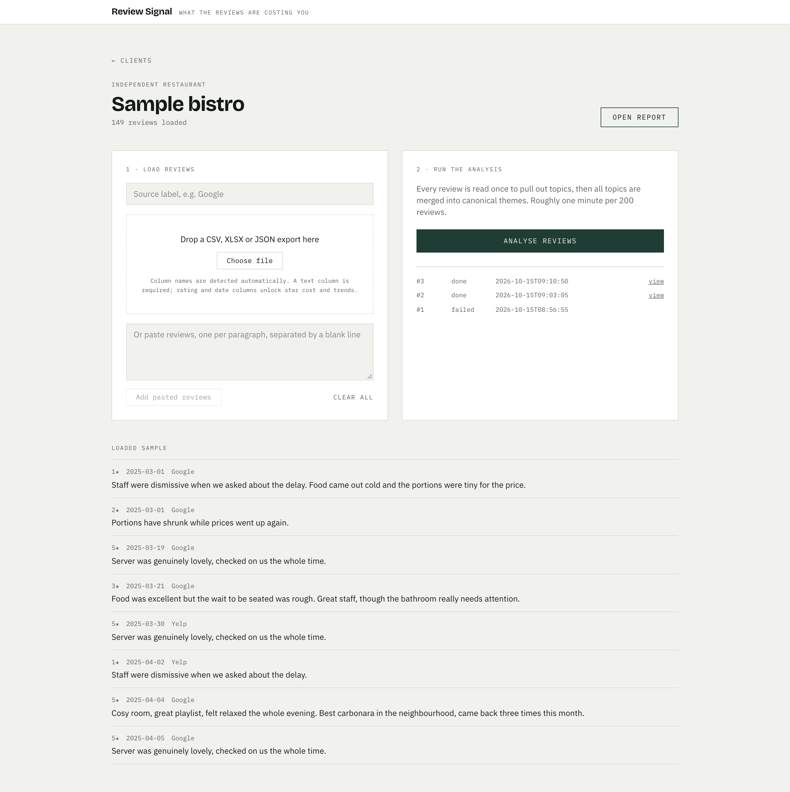
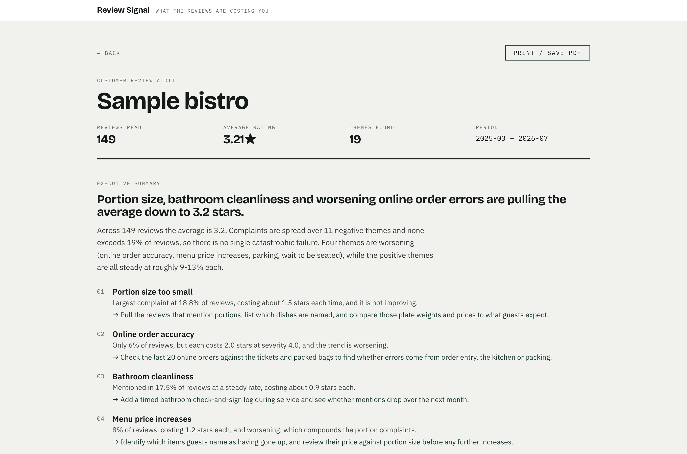

# Review Signal

Review Signal turns a pile of customer reviews into a ranked list of things to fix. You load a
business's review export, the model reads every review, near-duplicate complaints get merged
into canonical themes, and each theme is scored by how much it costs in rating. The output is
a printable audit report.

It is built as an operator tool: for someone who runs review audits for small businesses
(restaurants, shops, online stores) and hands the report back to the owner.



## The key metric: star cost

Most review tools count how often a topic comes up. Frequency alone doesn't tell an owner what
to fix first. A complaint that shows up in one review in five may barely move the rating, while
a rarer one may sink every review it appears in.

**Star cost** is the difference in average rating between reviews that mention a theme and
reviews that don't:

```
star_cost = avg_rating(reviews without the theme) − avg_rating(reviews with the theme)
```

From the bundled sample data (149 synthetic restaurant reviews):

| Theme                  | Share of reviews | Star cost |
| ---------------------- | ---------------- | --------- |
| Portion size too small | 18.8%            | −1.54★    |
| Online order accuracy  | 6.0%             | −2.00★    |
| Bathroom cleanliness   | 17.4%            | −0.91★    |

Online order errors appear in a third as many reviews as portion complaints, but each one
costs more. Star cost is only computed when the upload has a usable rating column and a theme
has at least three rated reviews.

Each theme also gets:

- **share** of reviews that mention it
- **average severity** (1–5, assigned per mention by the model)
- **trend**: the share in the most recent 120 days compared with the whole period (worsening / steady / improving)
- **priority**: share × severity × star cost × trend, used to order the work list

## What it does

1. **Ingest.** CSV, XLSX or JSON export, or pasted text. Text, rating, date, author and source
   columns are detected from common header names. Duplicate reviews are fingerprinted out.
2. **Extract.** Reviews are sent to the model in batches. For each review it returns the topics
   mentioned, with sentiment, severity and a verbatim excerpt.
3. **Consolidate.** A second pass merges near-duplicate labels ("slow service", "waited 40
   minutes", "long wait") into canonical themes. Without it the frequency counts are meaningless.
4. **Score.** Plain Python computes share, severity, star cost, monthly trend and priority.
   No model is involved in the numbers.
5. **Report.** A ranked work list, a praise list, a monthly volume and rating chart, and an
   optional executive summary written from the computed metrics. Print to PDF from the browser.

## Architecture



The model is called in three places, each returning JSON:

**Pass 1, extraction** (one call per batch of reviews):

```json
{"results": [{"id": 42, "topics": [
  {"label": "wait time at pickup", "category": "speed_wait_time",
   "sentiment": "negative", "severity": 3,
   "excerpt": "verbatim span from the review"}]}]}
```

**Pass 2, consolidation** (one call per 220 distinct raw labels):

```json
{"themes": [{"label": "Wait before seating", "category": "speed_wait_time",
             "polarity": "negative",
             "members": ["long wait", "waited 40 minutes", "slow to seat"]}]}
```

**Summary** (optional, on demand). The model sees only the computed metrics, never the raw
reviews, and returns a headline, a situation paragraph, 3–5 prioritised actions and strengths.

Model output is treated as untrusted input. Labels, sentiments and severities are clamped to
allowed values. Topics pointing at unknown review IDs are dropped. Labels the consolidation pass
forgot become their own theme, so no mention silently disappears. A theme's polarity is decided
by the majority sentiment of its mentions, not by the model's label. If more than a quarter of
the reviews fail extraction, the run fails instead of producing a partial report.

Data model: `projects` → `reviews` → `runs` → `themes` → `mentions` (one row per review/theme
pair with sentiment, severity and excerpt). Each analysis is a separate run, so re-running
keeps earlier reports.

## Screenshots

| Project: load reviews, run analysis | Theme detail: every mention with its excerpt |
| --- | --- |
|  |  |

## Stack

- **Backend:** Python, FastAPI, SQLite, pandas (file parsing), Anthropic Python SDK
- **Frontend:** React 18, Vite, Tailwind CSS 4
- **Model:** Claude via the Anthropic API, configurable with `ANTHROPIC_MODEL` (default `claude-sonnet-5-5`)

## Running locally

Requirements: Python 3.10+ and Node.js 18+, plus an Anthropic API key.

Backend:

```bash
cd backend
python -m venv .venv && source .venv/bin/activate
pip install -r requirements.txt
cp .env.example .env        # set ANTHROPIC_API_KEY
uvicorn app.main:app --reload --port 8000
```

Frontend, in a second terminal:

```bash
cd frontend
npm install
npm run dev                 # http://localhost:5174
```

Vite proxies `/api` to port 8000, so no CORS setup is needed in development.

To try it, create a project with business type "independent restaurant", upload
`sample_reviews.csv` from the repo root and run the analysis.

### Configuration (`backend/.env`)

| Variable            | Default                 | Purpose                               |
| ------------------- | ----------------------- | ------------------------------------- |
| `ANTHROPIC_API_KEY` | none                    | Required                              |
| `ANTHROPIC_MODEL`   | `claude-sonnet-5-5`     | Model used for all three passes       |
| `BATCH_SIZE`        | `20`                    | Reviews per extraction call           |
| `CONCURRENCY`       | `4`                     | Parallel extraction calls             |
| `DB_PATH`           | `review_signal.db`      | SQLite file                           |
| `CORS_ORIGINS`      | `http://localhost:5174` | Allowed origins outside the Vite proxy |

## Getting reviews in

There is no legal bulk API for Google or Yelp reviews of businesses you don't own. The
workable routes:

- The business exports its own reviews (Shopify review apps, Trustpilot and Yotpo export CSV).
- The business adds you as a manager on its Google Business Profile and you export from there.
- For small sets, paste reviews into the text box.

## Limitations

- `sample_reviews.csv` is synthetic, so the numbers above show the method, not a real business.
- Star cost is a difference in averages, not a causal estimate. A review that mentions several
  problems counts towards each of them.
- Severity is a model judgement and can vary between runs. Theme names can also vary slightly
  between runs because consolidation is done by the model.
